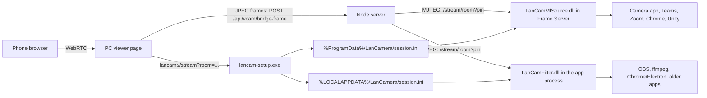

# LAN Phone Camera Driver — Architecture

## 1. System context

Only the right half lives in this repository. The server and viewer page belong to the parent project (`docs/architecture.md` §12 there).

## 2. Components

| File | Output | Responsibility |
|---|---|---|
| `src/lancam_mfsource.cpp`, `.def` | `LanCamMfSource.dll` | Media Foundation source: `IMFMediaSourceEx`, `IMFMediaStream2`, `IKsControl`, `IMFGetService`, behind `LanCamMfActivate` (`IMFActivate`) and an `IClassFactory`. Pacing thread answers `RequestSample` tokens at 30 FPS; frames are converted BGR24 -> NV12 and letterboxed into 1280x720. Logs to `%ProgramData%/LanCamera/mfsource.log`. |
| `src/lancam_filter.cpp`, `src/dll_main.cpp`, `.def`, `include/lancam_filter.h`, `filter_guids.h` | `LanCamFilter.dll` | DirectShow source filter with one output pin (`IAMStreamConfig`, `IKsPropertySet`). `StreamLoop` blits each frame into the sample: vertical flip (RGB24 bottom-up DIB) and letterbox to the negotiated size (`BlitTopDownToBottomUp`). Black frame while no stream. |
| `include/mjpeg_decoder.h` | (header) | `MjpegDecoder`: WinHTTP client for the MJPEG stream, JPEG boundary scan, WIC decode to top-down BGR24. Reconnects every 0.5-1 s after errors. |
| `include/config_manager.h` | (header) | `LanCamSession` (host, port, room, PIN) and the two session files; `LoadLanCamSession()` (user file, DirectShow) and `LoadLanCamSessionMachine()` (ProgramData first, user file as fallback, Media Foundation). `SaveLanCamSession()` writes both. |
| `include/shm_bridge.h` | (header) | Win32 shared-memory reader/writer. **Not used in practice** (see decisions, DEC-005). |
| `src/lancam_setup.cpp` | `lancam-setup.exe` | Setup and protocol handler (see section 3). Manifest `asInvoker`. |
| `installer/lan-camera.iss` | `lan-camera-setupv<version>.exe` | Inno Setup wizard that installs the three binaries and calls the setup tool. |
| `build.bat` | | Compiles the three binaries (`/MT`) and runs Inno Setup. |

GUIDs: DirectShow filter `{708B7B2B-191B-4E3F-8C7E-F037A32F5112}`; Media Foundation source `{B8D0A5E7-6C31-4F0A-9E8B-2D4F7A1C5E93}`.

## 3. The setup tool (`lancam-setup.exe`)

| Invocation | Behavior |
|---|---|
| `lancam://stream?...` | Runs as the normal user, no UAC (about 100 ms): parses room/PIN/host/port, writes both session files, exits. Never opens the Camera app. |
| no arguments, or `--install` | Elevates through UAC if needed, checks that both DLLs sit next to the exe (else a clear message, exit 2), stops the Frame Server, copies files to `C:/Program Files/LanCamera` (skipped when already there; a mapped DLL is renamed aside and replaced), registers the DirectShow filter (`regsvr32` plus registry entries in `HKEY_CLASSES_ROOT`/`HKCU`) and the `lancam://` protocol, prepares `%ProgramData%/LanCamera` (ACL: Users and LOCAL SERVICE modify), registers the Media Foundation class (through `HKEY_CLASSES_ROOT`) and creates the virtual camera, then confirms Windows lists it. Shows a summary box unless `--silent`. Exit 0 = everything registered and listed, 1 = a part failed, 2 = files missing. |
| `--uninstall` | Elevated: removes the Media Foundation camera and class, unregisters the DirectShow filter and deletes the `lancam://`, CLSID and category-instance keys, stops the Frame Server. Files are deleted by the Inno uninstaller afterwards. |
| `--remove-mf` | Removes only the Media Foundation camera and class. |
| `--bridge` | Starts the shared-memory daemon on `127.0.0.1:7779`. Nothing starts it or feeds it. |
| `--silent` | Suppresses message boxes (combine with any mode). |

Media Foundation registration: `MFCreateVirtualCamera(MFVirtualCameraType_SoftwareCameraSource, MFVirtualCameraLifetime_System, MFVirtualCameraAccess_AllUsers, "LAN Phone Camera", <CLSID>, {KSCATEGORY_VIDEO_CAMERA}, 1)` then `Start`. The function is found with `GetProcAddress` in `mfsensorgroup.dll`, so the tool still starts on systems without it and reports that Windows 11 is needed.

## 4. Frame and data flow

1. The camera is opened by an application. Windows starts the source (Frame Server for Media Foundation; the filter is loaded into the application for DirectShow).
2. The source reads `LanCamSession` (room, PIN, host, port; default `127.0.0.1:7777`, room `123`).
3. `MjpegDecoder` connects to `http://<host>:<port>/stream/<room>?pin=<pin>`. The server then (a) already has frames from the viewer page's `bridge-frame` posts, or (b) asks the phone to upload MJPEG (`mjpeg:demand`).
4. Each JPEG is decoded to BGR24 and the newest frame is kept.
5. On every sample request (30 FPS) the newest frame is letterboxed into 1280x720 and delivered (NV12 for Media Foundation, flipped RGB24 for DirectShow). With no frame yet the output is black; the last frame repeats if the stream stalls.

## 5. Installer (`installer/lan-camera.iss`)

- Installs `lancam-setup.exe`, `LanCamFilter.dll`, `LanCamMfSource.dll` to `{autopf}/LanCamera` (admin, 64-bit, no directory or group pages, `AppId` fixed so upgrades replace the old install).
- Before copying: `net stop FrameServer`; for each existing file, delete it or, if it is mapped by another process (Chrome, Claude, Electron apps), rename it to `*.oldN` and schedule it for deletion at reboot.
- After copying: runs `lancam-setup.exe --install --silent`; a non-zero result shows a warning with the log path (the files stay installed).
- Uninstall: `lancam-setup.exe --uninstall --silent`, then removes `*.old*` and `%ProgramData%/LanCamera`.
- Built by `build.bat` with `/DAppVersion=<version> /DBuildDir=<build> /DOutDir=<output>`; the output is `lan-camera-setupv<version>.exe`, and older `lan-camera-setupv*.exe` in the output folder are deleted.

## 6. Build requirements

Visual Studio 2022 Community with the C++ desktop workload (`vcvars64.bat`, Windows SDK 10.0.26100 or newer for `mfvirtualcamera.h`), and Inno Setup 6 (`ISCC.exe` in Program Files (x86), Program Files, or `%LOCALAPPDATA%/Programs`). All three binaries link the C runtime statically (`/MT`), so they depend only on Windows DLLs (kernel32, user32, ole32, shell32, advapi32, winhttp, ws2_32, mf, mfplat).

## 7. Failure handling and diagnostics

| Symptom | Where to look |
|---|---|
| Installer reports a failure | `%ProgramData%/LanCamera/setup.log` (HRESULTs, copy/rename results, `listed by Windows: 0/1`) |
| Camera listed but black | `%ProgramData%/LanCamera/mfsource.log` (`stream start`, `first live frame`, `samples delivered`); check the room/PIN in the session file, and that the server shows an MJPEG subscriber |
| Camera app lists nothing | Windows 11? Enumerate with WinRT `DeviceInformation.FindAllAsync(DeviceClass.VideoCapture)`; if empty, the Media Foundation camera is not registered (run `lancam-setup.exe`) |
| DirectShow device missing | `ffmpeg -list_devices true -f dshow -i dummy` should list "LAN Phone Camera" |
| Old DLL cannot be replaced | Expected for mapped DLLs: the installer renames it aside; a reboot removes the `*.old*` files |

Known gotcha: opening `HKLM/SOFTWARE/Classes` directly for write was denied even when elevated, so every COM registration goes through `HKEY_CLASSES_ROOT`.
